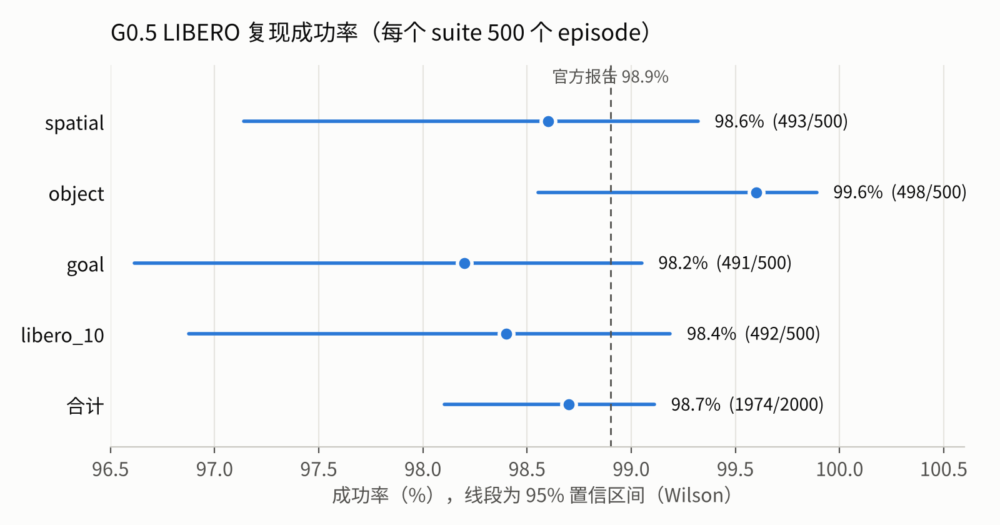
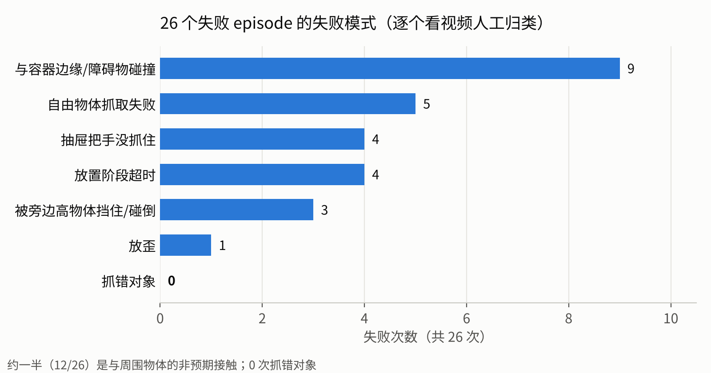
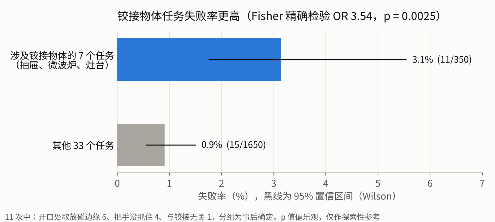

# 星海图 G0.5 · LIBERO 仿真复现

> 星海图 Galaxea「G0.5 复现与开源共创挑战」· 仿真复现方向
>
> 作者：吴思贤（Sixian Wu），University of Bristol / Bristol Robotics Laboratory，机器人硕士
>
> 技术分享帖（小红书）：[G0.5复现98.7%：26次失败我全看了](https://xhslink.cn/o/8PjnErVGezU)
>
> 复现录屏：[百度网盘](https://pan.baidu.com/s/1QIPjQF_tS3U34DCs5e2FuQ?pwd=mwfk)（提取码 `mwfk`），录屏内容与终端完整输出见 [`evidence/`](evidence/)

## 结果

在阿里云 PAI-DSW 单卡 A10 上完成 LIBERO 四个 suite 全量评测（4 suite × 10 任务 × 50 次 = 2000 个 episode）。

| Suite | 成功 / 总数 | 成功率 |
|---|---|---|
| libero_spatial | 493 / 500 | 98.6% |
| libero_object | 498 / 500 | 99.6% |
| libero_goal | 491 / 500 | 98.2% |
| libero_10 | 492 / 500 | 98.4% |
| **合计** | **1974 / 2000** | **98.70%** |

官方报告为 98.9%。2000 个样本、成功率约 99% 时，95% 置信区间约为 ±0.5%，复现结果与官方报告在统计上一致。原始结果见 [`evidence/results/`](evidence/results/)。



## 复现配置

| 项目 | 内容 |
|---|---|
| 模型 | G0.5，Hugging Face `OpenGalaxea/G05`，checkpoint `g05-libero`（step_100000） |
| 代码 | `OpenGalaxea/GalaxeaVLA`，commit `89f2322`，**未修改任何代码** |
| 权重校验 | `model.pt` sha256 = `432f225c7647bdab77bfa2c2b397dc38cf8631bd70c92b85b261ff2817c1e795`<br>`action_tokenizer.pt` sha256 = `5088f64a5452a60bbc8cac90ee7d79c156f1d14540bc3139aa7060f862dddace` |
| 仿真环境 | LIBERO（MuJoCo，EGL 离屏渲染），评测协议与官方 `scripts/run/eval_libero.sh` 一致，`num_trials=50` |
| 硬件 | 阿里云 PAI-DSW `ecs.gn7i-c8g1.2xlarge`：NVIDIA A10 24 GB，8 vCPU，30 GB 内存 |
| 软件 | Ubuntu 22.04，Python 3.10.16（uv 虚拟环境），PyTorch 2.7.1 + CUDA 12.8 |

### 资源与耗时

| 指标 | 数值 |
|---|---|
| 显存峰值（1 路环境，冒烟测试） | 9.3 GB |
| 显存（4 路并行环境） | 约 15.9 GB |
| 全量评测耗时 | goal 141 min · spatial 149 min · object 129 min · libero_10 233 min，合计约 10.9 小时 |
| 瓶颈 | CPU（物理仿真）。4 路并行时 CPU 约 87%、load average 9.7，GPU 利用率仅 0–26% |

评测为一个模型服务端 + 多个仿真环境的结构，`--num_parallel` 增加的是仿真环境数，显存不会成倍增长；在 8 vCPU 实例上把并行数调高不会提速。逐 5 秒的显存与 GPU 利用率记录见 [`evidence/logs/gpu_full.csv`](evidence/logs/gpu_full.csv)。

## 对代码与配置的修改

GalaxeaVLA 仓库代码未做修改。环境与 LIBERO 侧的改动如下：

1. **LIBERO 兼容 PyTorch ≥ 2.6**：`libero/libero/benchmark/__init__.py` 第 164 行
   ```diff
   - init_states = torch.load(init_states_path)
   + init_states = torch.load(init_states_path, weights_only=False)
   ```
   PyTorch 2.6 起 `weights_only` 默认为 True，无法加载 LIBERO 的初始状态文件（numpy 数组）。只放开这一处，没有使用全局环境变量。
2. **LIBERO 导入路径**：LIBERO 顶层目录缺少 `__init__.py`，新版 setuptools 的 editable 安装找不到包，在 site-packages 中添加 `libero_path.pth` 指向源码目录；LIBERO 以 `--no-deps` 安装，避免覆盖本仓库锁定的依赖。
3. **评测配置**：设置 `LIBERO_CONFIG_PATH`、`MUJOCO_GL=egl`、`HF_HUB_OFFLINE=1`；并行数用 4（脚本建议值为 10，但实例只有 8 vCPU）；其余参数均为默认。
4. **网络与下载**（不影响结果）：使用 hf-mirror 与阿里云 PyPI 镜像。

## 运行步骤

```bash
# 1. 环境、权重、LIBERO（scripts/setup_g05_libero.sh 已包含上述全部修改）
WORK=/mnt/workspace bash scripts/setup_g05_libero.sh env
WORK=/mnt/workspace bash scripts/setup_g05_libero.sh ckpt
WORK=/mnt/workspace bash scripts/setup_g05_libero.sh libero

# 2. 校验权重（必须在权重所在目录执行）
cd /mnt/workspace/GalaxeaVLA/checkpoints/g05-libero
echo "432f225c7647bdab77bfa2c2b397dc38cf8631bd70c92b85b261ff2817c1e795  model.pt" | sha256sum -c

# 3. 冒烟测试（libero_goal 10 个任务各 1 次）
WORK=/mnt/workspace bash scripts/setup_g05_libero.sh smoke

# 4. 全量评测：4 个 suite 依次运行，同时每 5 秒记录一次显存与 GPU 利用率
cd /mnt/workspace/GalaxeaVLA && source .venv/bin/activate
export LIBERO_CONFIG_PATH=$(pwd)/experiments/libero MUJOCO_GL=egl PYOPENGL_PLATFORM=egl HF_HUB_OFFLINE=1 TRANSFORMERS_OFFLINE=1
LOG=/mnt/workspace/logs
nvidia-smi --query-gpu=timestamp,memory.used,utilization.gpu --format=csv -l 5 > $LOG/gpu_full.csv &
for s in goal spatial object 10; do
  START=$(date +%s)
  bash scripts/run/eval_libero.sh checkpoints/g05-libero/model.pt --suites libero_$s \
    --num_trials 50 --num_parallel 4 --save_videos --output_dir outputs/full_libero_$s > $LOG/full_libero_$s.log 2>&1
  echo "libero_$s exit=$? 用时=$(( ($(date +%s) - START) / 60 ))min" >> $LOG/full_timing.txt
done
kill %1

# 5. 分析
python /path/to/this/repo/scripts/list_fail.py outputs/full_libero_*/summary.json
python /path/to/this/repo/scripts/articulated_stats.py outputs/full_libero_*/summary.json
```

## 失败分析

逐个查看全部 26 段失败视频并人工归类，逐条记录（视频文件名、suite、任务、episode、失败阶段、类别、描述）见 [`analysis/failure_analysis.csv`](analysis/failure_analysis.csv)。

| 失败模式 | 次数 |
|---|---|
| 与容器边缘/障碍物碰撞（碗碰抽屉边、物体碰篮子边、杯子卡微波炉门框、被把手挡住） | 9 |
| 自由物体抓取失败（没夹住、搬运中掉落、把物体碰倒） | 5 |
| 抽屉把手没抓住 | 4 |
| 放置阶段超时（碗已到盘子上方，220 步 / 11 秒用完） | 4 |
| 被旁边高物体挡住/碰倒 | 3 |
| 放歪 | 1 |
| 抓错对象 | **0** |



**观察：**

1. **没有一次失败是理解错指令或抓错对象**，失败全部发生在几何定位与接触层面。
2. **约一半（12/26）是与周围物体发生了非预期接触**，纯视觉策略对操作空间余量的感知不足。
3. **涉及铰接物体（抽屉、微波炉、灶台）的 7 个任务失败率为 3.1%（11/350），其他 33 个任务为 0.9%（15/1650）**，Fisher 精确检验 OR 3.54、p = 0.0025（[`scripts/articulated_stats.py`](scripts/articulated_stats.py)）。拆开看，11 次中 6 次是在抽屉/微波炉开口处取放时碰到边缘，4 次是没抓住抽屉把手，1 次与铰接无关；拧旋钮、推上抽屉几乎不失败。难点更可能在“开口处的空间余量”和“小把手的抓取精度”，而不是铰接本身。
4. 多个失败 episode 中出现了掉落后重新抓取、反复尝试把手等行为，最终因超时判负，说明策略具备闭环纠错能力，但纠正较慢。



**局限：** 样本仅 26 个，由一人标注，属于定性观察；铰接分组是在看到失败分布之后确定的（事后分组），p 值偏乐观，结论需针对性实验验证。“放置阶段超时”是否主要由时间上限导致，可通过只对这几个 episode 放宽步数上限来诊断（诊断结果不能与官方成绩比较）。

## 官方评测脚本的一个统计问题

录制复现录屏时发现：`experiments/libero/eval_libero_parallel.py` 在 **`--num_trials` 小于 `--num_parallel`** 时成功率统计有误。初始化阶段对每个并行环境都调用 `assign_trial`，没有检查 `num_trials`，多出来的 trial 也会运行并计入成功数，而分母仍是 `num_trials`。例如 `--num_trials 1 --num_parallel 4` 跑 libero_goal 时，汇总显示 24/10 = 240%。

- **本仓库的全量结果不受影响**：全量评测 `num_trials=50 ≥ num_parallel=4`，后续分配有 `next_trial_idx < num_trials` 的检查；每个 suite 的 total 均为 500，视频文件共 2000 个。
- 录屏中的现场评测使用 `--num_trials 4 --num_parallel 4`（40 个 episode，结果 39/40）。
- 已向官方仓库提交 Issue [#75](https://github.com/OpenGalaxea/GalaxeaVLA/issues/75) 和修复 PR [#76](https://github.com/OpenGalaxea/GalaxeaVLA/pull/76)（初始化时只在 `next_trial_idx < num_trials` 时分配 trial，其余环境保持空闲；附 CPU 单元测试，修复前 35 例中 13 例失败，修复后全部通过）。

## 复现中遇到的问题

| 问题 | 原因与解决 |
|---|---|
| `model.pt`（11.44 GB）sha256 与官方不一致 | 用 `aria2c -c` 接续 hf 下载了一半的 `.incomplete` 文件。hf/Xet 是分块乱序写入的，文件中间有大量未写入的全零空洞，aria2 在没有控制文件时把已有部分当作连续前缀跳过。`.pt` 本质是不压缩的 zip，于是按 zip 条目的 CRC32 逐条校验，定位到 238 个损坏条目（约 3.2 GB，抽样确认全为零字节），再按 128 MB 分块用 HTTP Range 重新下载覆盖；最后单独补上被空洞覆盖的文件头 30 字节。修复后 sha256 与官方一致，节省了约三分之二的重新下载时间 |
| LIBERO 加载初始状态报错 | PyTorch 2.6 起 `torch.load` 默认 `weights_only=True`，见上文修改 1 |
| `import libero` 失败 | 顶层缺少 `__init__.py`，见上文修改 2 |
| 编译 `egl-probe` 报 “CMake must be installed” | `apt-get install cmake build-essential libegl1-mesa-dev libgl1-mesa-dev libglvnd-dev`；不要用 pip 的 cmake 4.x |
| 国内访问 GitHub / PyTorch / HF 缓慢或超时 | gh-proxy 下载 zip；`UV_HTTP_TIMEOUT=600` 并循环重试；HF 走 hf-mirror 并关闭 Xet（`HF_HUB_DISABLE_XET=1`） |
| `sha256sum -c model.pt.sha256` 报找不到文件 | 校验文件里是相对文件名，需在 `checkpoints/g05-libero/` 目录内执行 |

## 目录

```
README.md
scripts/
  setup_g05_libero.sh     分阶段搭建脚本（含 LIBERO 兼容补丁）
  list_fail.py            列出未全部成功的任务
  articulated_stats.py    铰接/非铰接任务失败率对比与 Fisher 检验
analysis/
  failure_analysis.csv    26 个失败 episode 的逐条归类
  figures/                图表
evidence/
  README.md               录屏说明与文件清单
  results/                全量评测与录屏现场评测的 summary.json
  logs/                   评测日志、耗时、GPU 记录、录屏终端输出
```

## 许可

本仓库仅包含脚本、日志与分析。G0.5 模型权重遵循星海图的非商用社区许可，请从官方 Hugging Face 仓库获取。
